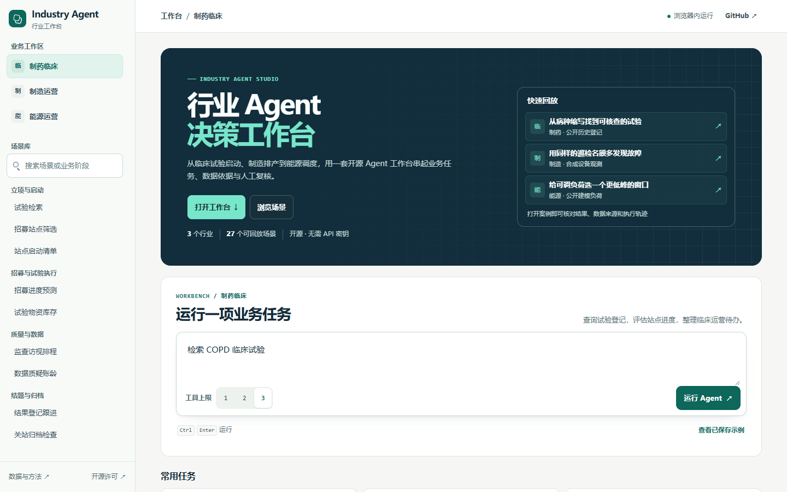
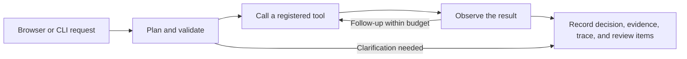

# Industry Agent Studio

**27 runnable business workflows for clinical trial operations, manufacturing, and energy.** Start with a business question, follow the agent's tool choices, and inspect the evidence behind each decision. The browser demo runs on GitHub Pages with no sign-in or API key.

[**Launch the interactive Studio →**](https://linxiushen.github.io/industry-ai-harnesses/) · [中文说明](README.zh-CN.md) · [Runtime architecture](ARCHITECTURE.md) · [Evidence and sources](#benchmark-evidence)

[](https://linxiushen.github.io/industry-ai-harnesses/)

## Try a decision workflow

| Who is deciding | What to try in the Studio | What to inspect |
| --- | --- | --- |
| Clinical operations analyst | Open **Trial search** and run the COPD example. | Open the ClinicalTrials.gov record for a search hit, then compare matched terms and archived indications. |
| Maintenance planner | Run a **manufacturing shift briefing** with a one-tool budget. Repeat with three. | See what gets deferred, then review inspection slots and draft work orders. In the bundled simulation, record 3022's draft cites 8.116 kW of mechanical power. |
| Energy operations planner | Try **flexible load scheduling**. | Compare the proposed operating window with a fixed 17:00 start at the same energy. The report counts how often moving the load made the peak worse. |

Select a scenario to load a **saved run** immediately. Choose **Run Agent** to recalculate with the current request and tool budget. The first live run downloads the pinned Python runtime from the Pages site. The result separates the decision overview, data evidence, and execution trace. Download the JSON to retain the input, used tools, observations, metrics, and items for human review.

## Scenario coverage

Each industry has nine scenarios. The original nine workflows include search, ranking, and forecasting benchmarks. The other 18 run individual operating decisions against labeled synthetic fixtures.

| Industry | Business stage | Runnable scenarios |
| --- | --- | --- |
| Clinical trial operations | Study planning and startup | Trial evidence search · recruiting location shortlist · site startup checklist |
| Clinical trial operations | Recruitment and execution | Enrollment projection · trial supplies inventory |
| Clinical trial operations | Quality and data | Monitoring visit queue · data query aging |
| Clinical trial operations | Closeout and archiving | Registry results follow-up · closeout readiness |
| Manufacturing | Planning and supply | Order capacity planning · material coverage and replenishment |
| Manufacturing | Production and quality | Finite-capacity scheduling · sampling and lot disposition |
| Manufacturing | Equipment and efficiency | Failure risk ranking · fixed-capacity inspection queue · work-order drafts · shift OEE loss analysis |
| Manufacturing | Shipping and traceability | Shipment traceability |
| Energy | Projects and investment | Rooftop PV screening · battery economics |
| Energy | Operations and response | Day-ahead load forecast · peak watch · flexible-load scheduling · demand response verification |
| Energy | Service and settlement | Service reliability review · bill reconciliation |
| Energy | Emissions reporting | Purchased electricity emissions |

[Clinical trial operations guide](verticals/pharma/README.md) · [Manufacturing guide](verticals/manufacturing/README.md) · [Energy guide](verticals/energy/README.md)

## Benchmark evidence

| Workload and comparator | Measured result | How to read it |
| --- | --- | --- |
| **Trial search.** Historical projection of 12 NCBI TrialGPT registry records, with six labeled positive queries. | MRR@3 **1.00 vs 0.67** for literal word matching. | Two positive queries use abbreviations in the project's dictionary. The comparison measures the ranker and dictionary on this small snapshot. Site screening and registry follow-up use fictional records. |
| **Inspection allocation.** Public UCI AI4I synthetic workload, with 55 labeled failures in the test split. Both policies get 300 inspection slots. | **37 of 55 vs 26 of 55** for tool wear alone. The model sent **263 false alerts**. Draft categories matched a recorded label for **32 of the 37** captured failures. | The replay uses two field-equivalent mirrors and measures a limited inspection queue. The work-order score is conditional on already capturing a failure. |
| **Day-ahead load and scheduling.** Final 336 hours of the REopt large-office modeled load profile. | Forecast MAE was **88.6 kW vs 32.5 kW** for the same hour last week. For scheduling, a movable block reduced the average daily peak by **3.3 kW** against a fixed 17:00 start at equal energy. | The weekly baseline won the forecast comparison. The test window had zero peak events, so it yields no alert sensitivity estimate. The calendar and flexible load are illustrative. |

The three industries have public engineering references for these decisions. TrialGPT starts with registry retrieval, Microsoft documents a maintenance review workflow, and BuildingsBench publishes short-term load forecasting benchmarks. [TrialGPT](https://github.com/ncbi-nlp/TrialGPT) · [Microsoft predictive maintenance project](https://github.com/microsoft/pdm-fabric-foundry) · [BuildingsBench](https://github.com/NatLabRockies/BuildingsBench)

The online Studio uses bundled inputs. The domain guides distinguish historical registry records, original simulations, and optional public benchmark downloads. They document source revisions, reuse terms, evaluation windows, and commands for reproducing the results above. [NCBI TrialGPT](https://github.com/ncbi-nlp/TrialGPT) · [UCI AI4I](https://doi.org/10.24432/C5HS5C) · [REopt reference data](https://github.com/NatLabRockies/REopt.jl/blob/35abb019e29532ef45d4a61c8dcecd2b8cdb74da/test/data/loads_kw_largeoffice_sanfran.csv)

## Run from the repository

Use Python 3.11+ and the standard library. The default command-line workflows run offline.

```sh
# Inspect what a one-tool budget leaves pending
python agent.py "Prepare a manufacturing shift briefing" --max-tools 1 --json

# Run the handoff and save the full audit record
python agent.py "Prepare a manufacturing shift briefing" --max-tools 3 --out output/shift.json

# Select one tool by its scenario ID
python agent.py manufacturing-shipment-trace --json

# Replay the nine original benchmark workflows
python run.py all --out output/decisions.json
```

The first command returns a report with `budget_exhausted` and exits with code 1. The pending inspection queue is recorded in the trace. Replace `all` with `pharma`, `manufacturing`, or `energy` to replay just that domain. The domain guides show how to supply a custom dataset. The CLI can also use a compatible model you already serve on localhost via `--local-model YOUR_MODEL`. [Local model setup](ARCHITECTURE.md#run-locally) · [Build the website](ARCHITECTURE.md#build-the-website)

## What the harness does

A shared Python graph powers the CLI and the browser worker. The default planner reads Chinese or English task text against the scenario catalog. It filters execution to registered tools, asks for clarification when it cannot plan the request, and can use an observation to queue a follow-up tool while budget remains. Industry code performs retrieval, scoring, forecasting, or rules-based calculations. Review items keep decisions such as site outreach, maintenance orders, and scheduling proposals available for a human to check.



PocketFlow provides the graph primitives. The GitHub Pages build serves the pinned Pyodide runtime, the scenario catalog, and saved examples. Outputs include the request, final status, data and its provenance where available, step list, tool reports, and review items. [Architecture and deployment](ARCHITECTURE.md) · [Framework and data attribution](THIRD_PARTY.md) · [MIT license](LICENSE)

Run the agent contract tests with `python -m unittest discover -s tests -v`. GitHub Actions exercise the offline workflows and the browser worker, then check the public studio after deployment. [Replay workflow](https://github.com/Linxiushen/industry-ai-harnesses/actions/workflows/replay.yml) · [Pages workflow](https://github.com/Linxiushen/industry-ai-harnesses/actions/workflows/studio.yml)
