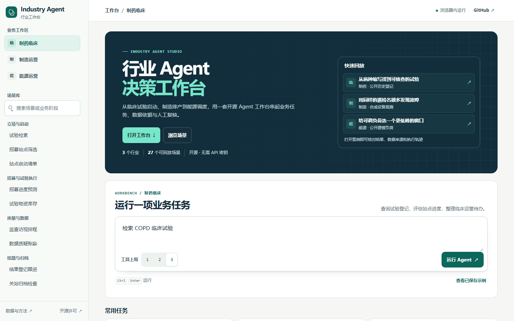
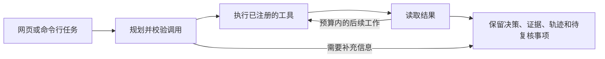

# 行业 Agent 工作台

**3 个行业，27 个可运行的业务场景。** 从实际工作问题出发，查看 Agent 选了哪些工具、用了什么数据、为什么提出这个建议。打开 GitHub Pages 网页即可体验，无需登录或申请 API 密钥。

[**打开在线工作台 →**](https://linxiushen.github.io/industry-ai-harnesses/) · [English](README.md) · [运行架构](ARCHITECTURE.md) · [基准结果与数据](#基准结果与数据)

[](https://linxiushen.github.io/industry-ai-harnesses/)

## 先试三个完整任务

| 业务角色 | 在线怎么试 | 重点看什么 |
| --- | --- | --- |
| 临床运营分析员 | 打开「试验检索」，运行 COPD 示例。 | 打开命中结果的 ClinicalTrials.gov 记录，核对匹配术语和历史适应证。 |
| 维护计划员 | 用 1 个工具运行「设备运维交接」，再把预算提高到 3 重跑。 | 先看哪些工作留待处理，再看巡检名单和工单草稿。模拟案例中，记录 3022 的草稿引用了 8.116 kW 的机械功率。 |
| 电力运营计划员 | 选择「可调负荷排班」。 | 在用电量相同的前提下，对照固定 17:00 启动的方案。报告也会统计改时段后峰值升高的天数。 |

点选场景即可查看**已保存的运行**。点击**运行 Agent**，会按当前任务和工具预算重新计算。首次实时运行会从 Pages 下载固定版本的 Python 运行时。结果分为概览、数据依据与执行轨迹，可下载 JSON 留存请求、工具结果、指标、观察与人工复核事项。

## 27 个场景覆盖哪些环节

每个行业提供 9 个场景。原有 9 个场景包括检索、风险排序和预测基准。新增的 18 个场景使用标明来源的合成数据，运行单项运营决策。

| 行业 | 业务环节 | 可运行场景 |
| --- | --- | --- |
| 制药临床运营 | 立项与启动 | 试验检索 · 招募站点筛选 · 站点启动清单 |
| 制药临床运营 | 招募与试验执行 | 招募进度预测 · 试验物资库存 |
| 制药临床运营 | 质量与数据 | 监查访视排程 · 数据质疑账龄 |
| 制药临床运营 | 结题与归档 | 结果登记跟进 · 关站归档 |
| 制造运营 | 计划与供应 | 订单产能核算 · 物料缺口与补货 |
| 制造运营 | 生产与质检 | 有限产能排产 · 抽检与质量处置 |
| 制造运营 | 设备与效率 | 故障风险排序 · 限额巡检 · 维修工单草稿 · 班次 OEE 损失分析 |
| 制造运营 | 发运与追溯 | 异常批次出货追溯 |
| 能源运营 | 项目与投资 | 光伏项目初筛 · 储能收益评估 |
| 能源运营 | 运行与响应 | 日前负荷预测 · 尖峰预警 · 可调负荷排班 · 需求响应核验 |
| 能源运营 | 服务与结算 | 供电可靠性复盘 · 电费账单对账 |
| 能源运营 | 碳排报告 | 购电碳排核算 |

[制药临床运营说明](verticals/pharma/README.md) · [制造运营说明](verticals/manufacturing/README.md) · [能源运营说明](verticals/energy/README.md)

## 基准结果与数据

| 数据与对照 | 实际测得 | 结果适用范围 |
| --- | --- | --- |
| **试验检索**。NCBI TrialGPT 的 12 条历史登记记录，6 条带相关性标签的正例查询。 | MRR@3 **1.00**，字面词匹配为 **0.67**。 | 两条正例查询使用了项目词表里的缩写。分数衡量小样本上排序与词表的共同效果。站点筛选与登记跟进使用虚构记录。 |
| **分配巡检名额**。UCI AI4I 公开合成数据，测试集有 55 个标注故障，两种方案各有 300 个巡检名额。 | 模型找到 **37/55**，仅按刀具磨损排序找到 **26/55**。模型同时产生 **263 个误报**。37 个命中故障中有 32 条工单草稿的类别与记录标签相符。 | 结果来自两个数值逐字段一致的公开镜像。工单类别分数只计算已被巡检队列捕获的故障。 |
| **日前负荷预测与排班**。REopt 办公楼建模曲线的最后 336 小时。 | 预测 MAE **88.6 kW**，上周同小时基线为 **32.5 kW**。保持用电量相同，可调负荷排班较固定 17:00 启动平均降低 **3.3 kW** 日峰值。 | 简单的周周期基线预测更准。测试时段没有尖峰事件，无法估计预警灵敏度。曲线采用示例日历，新增负荷是模拟的。 |

这三个行业都有对应的公开工程项目。TrialGPT 从登记库检索开始，微软提供设备运维复核工作流，BuildingsBench 发布短期用电负荷预测基准。[TrialGPT](https://github.com/ncbi-nlp/TrialGPT) · [微软设备运维项目](https://github.com/microsoft/pdm-fabric-foundry) · [BuildingsBench](https://github.com/NatLabRockies/BuildingsBench)

在线工作台使用随项目打包的输入。各行业说明区分历史登记数据、项目自建的合成运营数据和可选公共基准，提供数据版本、许可、评测区间与复现命令。[NCBI TrialGPT](https://github.com/ncbi-nlp/TrialGPT) · [UCI AI4I](https://doi.org/10.24432/C5HS5C) · [REopt 参考数据](https://github.com/NatLabRockies/REopt.jl/blob/35abb019e29532ef45d4a61c8dcecd2b8cdb74da/test/data/loads_kw_largeoffice_sanfran.csv)

## 在本地复现

在仓库根目录使用 Python 3.11+ 运行。默认模式只用标准库，可以离线执行。

```sh
# 用一个工具跑运维交接，查看还剩哪些待办
python agent.py "设备运维交接" --max-tools 1 --json

# 跑完整交接，保存工具调用和依据
python agent.py "设备运维交接" --max-tools 3 --out output/shift.json

# 按场景 ID 运行单个工具
python agent.py manufacturing-shipment-trace --json

# 批量回放最初的九个基准工作流
python run.py all --out output/decisions.json
```

第一条命令会生成 `budget_exhausted` 状态的报告，并以退出码 1 结束。尚未执行的巡检排队任务仍保留在轨迹中。把 `all` 换成 `pharma`、`manufacturing` 或 `energy` 可单独回放一个行业。各行业说明包含自带数据的格式。命令行可通过 `--local-model 模型名` 接入你已在本机运行的兼容模型。[本地模型接入](ARCHITECTURE.md#run-locally) · [网页构建](ARCHITECTURE.md#build-the-website)

## Agent 和 Harness 如何配合

网页和命令行共用同一套 Python 流程。内置规划器按任务文本和场景库选择已注册的工具，支持中英文任务。信息不足时会要求补充，预算允许时会根据工具结果安排下一步。各行业工具独立完成检索、评分、预测或者规则计算。站点联系、维修工单和负荷安排等事项会交给工作人员复核。



流程使用 PocketFlow 的节点和图执行能力。GitHub Pages 提供固定版本的 Pyodide、场景目录和运行示例。导出的 JSON 保留原始任务、结束状态、数据及可用的来源信息、步骤、各工具报告和人工复核事项。[架构和部署](ARCHITECTURE.md) · [框架与数据署名](THIRD_PARTY.md) · [MIT 许可证](LICENSE)

可用 `python -m unittest discover -s tests -v` 运行 Agent 流程测试。GitHub Actions 运行离线工作流和浏览器执行测试，部署后读取公开页面和演示数据。[离线回放](https://github.com/Linxiushen/industry-ai-harnesses/actions/workflows/replay.yml) · [Pages 发布](https://github.com/Linxiushen/industry-ai-harnesses/actions/workflows/studio.yml)
